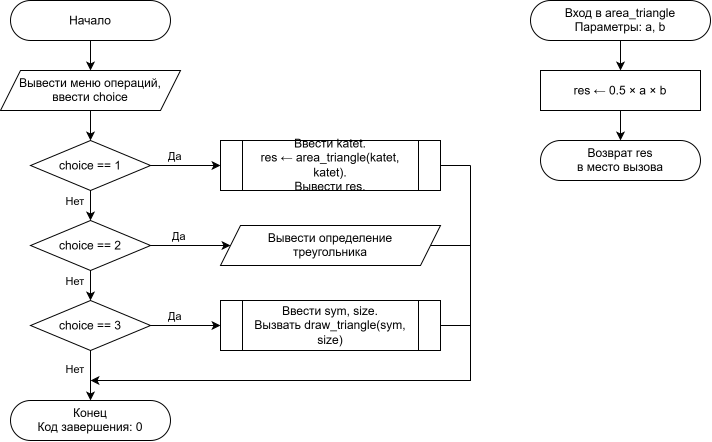

# Домашнее задание

## Условие задачи
Составьте программу, которая для заданной пользователем фигуры, например прямоугольника (треугольника или другой фигуры см. инидивидуальное задание работы 9) предлагает меню выбора одной из операций:
1) рассчитать площадь;
2) вывести определение фигуры;
3) нарисовать фигуру.

---

## 1. Алгоритм и блок-схема

### Алгоритм
1. Начало функции. Получение вещественных значений катетов a и b в качестве параметров.
2. Вычисление площади прямоугольного треугольника по формуле: 0.5 * a * b.
3. Возврат вычисленного значения площади типа float в вызывающую функцию main.
4. Конец функции.

### Блок-схема

[]()
## 2. Реализация программы
```c
printf("Меню операции для прямоугольного треугольника:\n1 - Рассчитать площадь\n2 - Вывести определение\n3 - Нарисовать контур\nВыбор: ");
scanf("%d", &choice);
if (choice == 1)
{
    float katet;
    printf("Введите длину катета: ");
    if (scanf("%f", &katet) == 1)
    {
        float res = area_triangle(katet, katet);
        printf("Площадь: %f\n", res);
    }
}
else if (choice == 2)
{
    printf("Прямоугольный равнобедренный треугольник — треугольник, у которого один угол прямой, а два катета равны.\n");
}
else if (choice == 3)
{
    char sym;
    int size;
    printf("Введите символ: ");
    scanf(" %c", &sym);
    printf("Введите размер: ");
    if (scanf("%d", &size) == 1 && size >= 2)
    {
        draw_triangle(sym, size);
    }
}

float area_triangle(float a, float b)
{
    return 0.5f * a * b;
}
```
## 3. Результат работы программы
Ввод: 1 4.0

Вывод: 8.000000
## 4. Информация о разработчике
Гаврилова Анна, бИД-262
